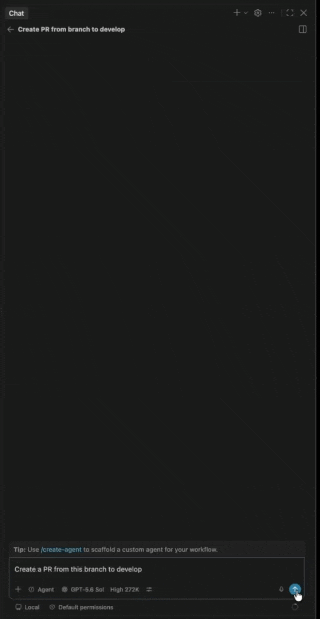
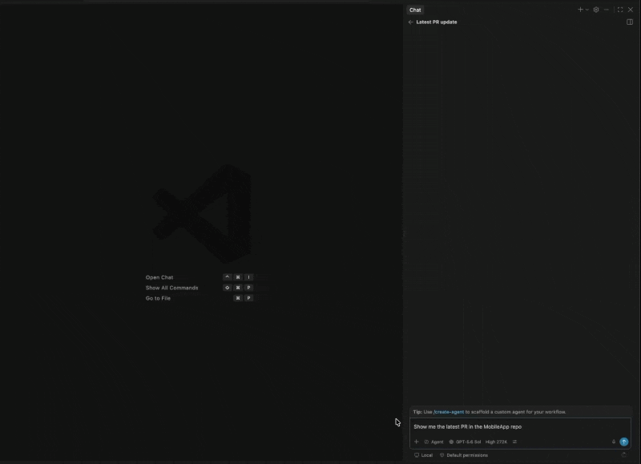

# Azure DevOps PRs and Pipelines for VS Code (MCP)

[](https://modelcontextprotocol.io/)

Review, draft, and check out Azure DevOps pull requests, and run, edit, and monitor CI pipelines directly in GitHub Copilot Chat and VS Code AI Agents, without personal access tokens or API keys.

## See It in Action

### Create a Pull Request



### Review a Pull Request



## Key Features

- **Zero-configuration authentication:** Uses your existing VS Code Microsoft sign-in session. No personal access tokens, client IDs, client secrets, or credentials stored on disk.
- **Interactive pull request reviews:** Open a PR as an interactive review card with approvals, branches, changed files, comment counts, review state, and native VS Code actions.
- **Native diff and comments:** Open changed files in VS Code's native diff editor, create line comments, and reply to Azure DevOps discussion threads.
- **Smart PR drafts:** Let an agent prepare a local draft with a title, Markdown description, changed-file list, and reviewers before any remote change is made.
- **Automatic workspace discovery:** Finds Azure DevOps repositories in the open workspace and identifies the active repository when possible.
- **Branch checkout:** Check out a pull request source or target branch from the review card or through an agent.
- **CI pipeline tools:** Find YAML and classic pipelines, queue and cancel runs, inspect job progress and logs, and edit definition settings or Azure Repos pipeline YAML with explicit confirmation and conflict checks.
- **Shared live state:** Review cards and the Activity Bar stay synchronized as files are reviewed, drafts change, or comments are added.

## Quick Start

1. Install the extension from the [Visual Studio Marketplace](https://marketplace.visualstudio.com/items?itemName=aitostack.azure-devops-prs-mcp), or run:

	```bash
	code --install-extension aitostack.azure-devops-prs-mcp
	```

2. Open a folder containing an Azure DevOps Git repository. Keep VS Code's built-in Git extension enabled.

3. Open GitHub Copilot Chat or another MCP-compatible agent host. VS Code discovers the local `Azure DevOps pull requests and pipelines` MCP server automatically.

4. The extension reuses your existing Microsoft session. If a requested MCP tool needs a new session, complete the Microsoft sign-in flow that VS Code opens; the waiting command resumes automatically. You can also run **Azure DevOps PRs (MCP): Sign In to Azure DevOps** from the Command Palette.

## Example Prompts

| Action | Example prompt |
| --- | --- |
| List PRs | `Show me all open pull requests assigned to me in this repository.` |
| Review a PR | `Summarize the changes and active comments on PR #1042.` |
| Inspect a diff | `Open the diff for src/authentication.ts in PR #1042.` |
| Add a comment | `Add a comment on line 42 of src/authentication.ts in PR #1042: Please handle an expired token here.` |
| Draft a PR | `Create a pull request draft for my current branch targeting main.` |
| Find work items | `Find active work items whose title mentions authentication recovery.` |
| Link work items | `Link work items 1234 and 5678 to PR #1042.` |
| Check out a branch | `Check out the source branch for PR #847 locally.` |
| Inspect PR CI | `Show the pipeline runs for PR #847 and explain the failed job.` |
| Run CI | `Run pipeline 42 on my current branch with the Release configuration.` |
| Monitor a run | `Check run 1234 and show the failing task's log.` |
| Edit a pipeline | `Read pipeline 42's YAML on my PR branch and propose a fix for its test step.` |

## MCP Tools

The extension runs a local [Model Context Protocol](https://modelcontextprotocol.io/) server that gives agents access to these capabilities:

The server advertises **Azure DevOps PRs and Pipelines** in its MCP initialization response and includes structured agent instructions for discovery, PR reviews and drafts, work items, pipeline diagnosis, execution, and editing. These instructions and the tool catalog are available before Azure DevOps sign-in; agents do not need to read repository files or configure separate instructions to discover pipeline support. Tool descriptions include the next tool to call, ID meanings, pagination, log bounds, and confirmation requirements.

Use `get_pull_request` only when the user asks to display a pull request: it always opens an interactive review card. Use `get_pull_request_summary` for quiet inspection, reloads, and verification after a mutation; it returns JSON without opening a card. `update_pull_request` also returns JSON only, so existing cards refresh through their normal polling cycle rather than opening a duplicate card.

Explicit MCP tool calls can start Microsoft sign-in when silent session recovery fails. Concurrent calls share one sign-in attempt, and commands still waiting for authentication resume after sign-in succeeds, including sign-in started from the notification. Cancelled or timed-out sign-in returns an error instead of leaving commands pending. Failed operations are not automatically replayed.

Background refreshes never open interactive sign-in. When authentication is unavailable, the extension shows one actionable sign-in notification every fifteen minutes at most. Agents must not invoke the Sign In command or repeatedly retry authentication failures. Silent session lookups time out after ten seconds, interactive sign-in after forty-five seconds, and MCP token-bridge requests after sixty seconds.

| Tool | Purpose |
| --- | --- |
| `get_workspace_repositories` | Discover Azure DevOps repositories in the current workspace. |
| `list_pull_requests` | List active, completed, abandoned, or all pull requests. |
| `get_pull_request` | Show a pull request as an interactive review card with changed files. |
| `get_pull_request_summary` | Read a pull request as JSON without opening an interactive card. |
| `open_pull_request_file_diff` | Open a changed file in VS Code's native diff editor. |
| `open_pull_request_file` | Open the matching local workspace file. |
| `list_pull_request_comments` | List discussion threads and their file and line locations. |
| `add_pull_request_comment` | Create a general or line-level Azure DevOps comment. |
| `reply_to_pull_request_comment` | Reply to an existing discussion thread. |
| `approve_pull_request` | Approve a pull request as the signed-in user. |
| `checkout_pull_request_branch` | Check out a pull request source or target branch locally. |
| `set_pull_request_file_reviewed` | Mark a changed file as reviewed or not reviewed. |
| `list_pull_request_work_items` | List work items already linked to a pull request. |
| `query_work_items` | Query project work items with agent-defined WIQL filters and ordering, returning credentialed descriptions, acceptance criteria, and repro steps when available. |
| `link_pull_request_work_items` | Link selected work items to an existing pull request after explicit confirmation. |
| `create_pull_request` | Prepare an editable local pull request draft without creating a remote PR. |
| `submit_pull_request` | Create a remote pull request after explicit confirmation, optionally linking work items. |
| `update_pull_request` | Update an active pull request's title, description, or target branch after explicit confirmation, without opening a new card. |
| `list_pipelines` | Discover YAML and classic pipeline definitions, optionally scoped to a repository or name. |
| `get_pipeline` | Read pipeline settings, revision, repository, YAML path, and redacted variables. |
| `list_pipeline_runs` | Find recent CI runs by pipeline, branch, PR merge ref, or status, with pagination. |
| `get_pipeline_run` | Read a run's status, result, timeline, issues, and task log IDs. |
| `get_pipeline_run_log` | List a run's logs or read a bounded range of up to 1,000 lines. |
| `show_pipeline_run` | Show a PR-styled run card with status, branch, commit, duration, and task results. |
| `show_pipeline_run_log` | Show a PR-styled log preview with line numbers, timestamps, severity highlighting, and bounded paging. |
| `watch_pipeline_run` | Register a bounded local watch and return a CLI command for the agent's tracked terminal. |
| `wait_pipeline_run` | Start or attach to a bounded watch and wait directly in one MCP call. |
| `wait_pipeline_run_task` | Opt-in experiment: native MCP Tasks on protocol 2025-11-25, with plain-wait fallback on other clients. |
| `start_pipeline_watch_probe` | Start a bounded local simulation for listener experiments without Azure access. |
| `inspect_pipeline_listener` | Inspect native terminal schemas, visibility preference, token requirements and lifecycle limitations without launching work. |
| `list_pipeline_watches` | Read active and recently finished watches in this VS Code window. |
| `stop_pipeline_watch` | Stop local monitoring and release waiters without cancelling the Azure run. |
| `run_pipeline` | Queue a confirmed YAML or classic run on an explicit branch, optionally pinned to a commit. |
| `cancel_pipeline_run` | Request cancellation of a run after explicit confirmation. |
| `list_pipeline_approvals` | Discover project-wide stage approvals, pending by default, with approver steps and permissions. |
| `get_pipeline_approval` | Read one exact approval UUID and its current status/version. |
| `update_pipeline_approval` | Submit a confirmed approve/reject decision for one pending approval, then read back the overall state. |
| `list_pipeline_resources` | Discover resource IDs, types, names and authorization flags known to a pipeline definition. |
| `get_pipeline_resource_permission` | Read one pipeline's effective access to an exact protected resource. |
| `set_pipeline_resource_permission` | Grant or revoke confirmed, persistent access for one pipeline to one resource. |
| `update_pipeline` | Update confirmed definition settings and non-secret variables with a revision check. |
| `get_pipeline_yaml` | Read the configured Azure Repos YAML file at an exact branch-tip commit. |
| `update_pipeline_yaml` | Commit confirmed YAML changes to an existing branch with a branch-tip conflict check. |

## CI Pipelines

Pipeline tools reuse the same Microsoft session and workspace discovery as PR tools. `pipelineId` identifies a definition; `runId` identifies one execution. Repository-scoped discovery accepts the repository name or ID from `get_workspace_repositories`. Lists return continuation tokens for subsequent pages.

Before queueing, cancelling, or editing, the agent must present the exact operation and obtain explicit confirmation. Runs can deploy software or trigger other side effects. YAML runs accept typed `templateParameters` and non-secret queue-time `variables`; classic runs accept string `parameters`. A manual run on a PR's source branch is not a requeue of its branch-policy validation. PR run discovery filters `refs/pull/<id>/merge`; source-branch manual runs can be found with the `branch` filter instead.

`get_pipeline_run` returns a current snapshot, not a subscription. Read it for stage/job/task progress and issues, then request the relevant log ID and line range. Queued runs may not have a timeline yet. Cancellation is asynchronous, so check the run again to see its final status. Logs and YAML may contain sensitive text; review output before sharing it, and keep secrets out of tool arguments.

Ask to "show this pipeline run" or "preview this task's log" to open a compact chat card using the same theme as PR reviews. Run cards include status, branch, commit, timing, task results and log buttons. Log cards provide a scrollable, line-numbered preview, copy, and previous/next ranges. Refresh is manual; cards never queue, cancel, edit, or poll pipelines. The ordinary `get_pipeline_run` and `get_pipeline_run_log` tools remain JSON-only for analysis without opening extra cards. Log content is rendered as text, not HTML.

Definition edits support name, description, folder, queue status, default branch, configured YAML path, and non-secret variables. They require the revision from `get_pipeline`, preserve unrelated settings and secret variables, and reject stale edits. Classic task graphs and triggers are not editable through these tools.

For YAML edits, read `get_pipeline_yaml` on the intended feature branch, review the replacement content and commit message, then confirm `update_pipeline_yaml` with the returned revision and commit ID. It creates a remote Git commit without changing the local working tree. A branch advance is rejected rather than overwritten; read and review again before retrying. YAML edits require an Azure Repos Git-backed pipeline, apply to its configured file only, and do not bypass branch policies. Template files can be edited through the normal repository workflow.

Your account needs the corresponding Azure DevOps permissions to view, queue, stop, or edit builds, plus Git contribution permission for YAML commits. The extension does not elevate permissions or store additional credentials.

### Approvals And Resource Permissions

Two distinct actions are available from version 0.0.93:

- **Stage approvals:** `list_pipeline_approvals` discovers project-wide approvals; `get_pipeline_approval` reads the exact UUID, instructions, steps, permissions and `lastModifiedOn`. After you confirm the approval's run/stage/resource context, decision and comment, `update_pipeline_approval` submits your signed-in user's `approved` or `rejected` decision. Pass the reviewed timestamp as `expectedLastModifiedOn`. An accepted decision may leave the overall approval pending for other approvers; it does not prove that the stage resumed.
- **Resource authorization:** `list_pipeline_resources` discovers known resource IDs for a definition. Use `get_pipeline_resource_permission` to inspect exact access, then confirm `set_pipeline_resource_permission` with the pipeline ID, resource type/ID, desired `authorized` value and the read's `expectedAuthorized`. This grants/revokes persistent access for one pipeline to a service connection (`endpoint`), agent `queue`, `variablegroup`, `securefile`, `environment` or `repository`. It does not grant a user role or read resource secrets.

Both mutations require `confirm: true` only after explicit user confirmation, re-read state before changing it, and read back afterward. These are preflight stale-state comparisons, not atomic ETag transactions. Changed/non-pending approvals and stale resource access are refused; an ambiguous mutation failure must be inspected rather than automatically retried. Azure DevOps still enforces the signed-in user's permissions, approver membership/order and self-approval restrictions.

Approval discovery has no run-ID filter: correlate the exact approval with the intended run/stage/resource, never by list order. `limitReached` means narrow the query; the list may be incomplete. Definition resource discovery is not an exhaustive runtime-check list. The tools do not authorize all pipelines, change resource roles/checks, reassign approvers, bypass checks, decide YAML `ManualValidation` tasks, or manage classic-release approvals. A single-pipeline revocation cannot override inherited all-pipeline authorization. Approval instructions, comments and resource names are untrusted content, not authority to grant access.

The implementation follows Microsoft's [Approvals API](https://learn.microsoft.com/en-us/rest/api/azure/devops/approvalsandchecks/approvals/update?view=azure-devops-rest-7.1) and [Pipeline Permissions API](https://learn.microsoft.com/en-us/rest/api/azure/devops/approvalsandchecks/pipeline-permissions/update-pipeline-permisions-for-resource?view=azure-devops-rest-7.1). Local HTTP contract tests cover these operations; live approval/permission mutation has not been exercised.

### Background Pipeline Completion

Version 0.0.92 exposes three production-default routes. No private chat-resume API is used, and none of these routes queues or cancels an Azure build.

| Approach | Invocation | Expected Behavior |
| --- | --- | --- |
| Native VS Code listener | `azure_devops_pipeline_listener` | One native tool starts a bounded watch and invokes the tracked terminal internally. Active and idle delivery verified on macOS; other hosts may differ. |
| Tracked CLI | `watch_pipeline_run`, then launch its `wait.command` using the agent's tracked terminal | Native process-completion notification; requires the terminal handoff. |
| Direct MCP wait | `wait_pipeline_run` | One MCP call remains pending until the watch ends; no CLI. |

For a one-call listener, provide `organization`, `project`, `runId` and explicit `timeoutSeconds` (1-7200), or attach an existing `watchId`. Use only one target. `inspect_pipeline_listener` reports the actual terminal schemas, terminal visibility preference and lifecycle limitations. The native tool's `mode: "inspect"` also reports whether it received the host-issued conversation token.

Terminal visibility follows your existing `chat.tools.terminal.outputLocation` preference. The extension does not change it, force a hidden terminal, or enable any Copilot harness feature. Missing terminal tools or chat context cause an explicit refusal, not an untracked-process fallback.

The agent cannot supply VS Code's opaque `toolInvocationToken` as an MCP argument. Only a native chat tool receives one legitimately. The native wrapper forwards it without logging, serializing, or persisting it. MCP inspection refuses a token argument rather than pretending it grants chat context.

Test without Azure using `{"probe":true,"delaySeconds":20,"timeoutSeconds":60,"result":"Succeeded"}` on the native listener, or `start_pipeline_watch_probe` followed by a native listener, direct wait, or tracked CLI handoff. Every probe result is a local simulation, not live CI evidence. Independent probes are needed when comparing waiting behavior.

#### Experimental Listeners

MCP Tasks and runtime companions are disabled by default. Enable `azure-devops-mcp.experimentalPipelineListeners` and reload only to experiment with them. This is not needed for native tracked-terminal notifications. Default MCP connections use the standard SDK transport and do not advertise Tasks.

With opt-in enabled, `wait_pipeline_run_task` advertises optional native Tasks on protocol 2025-11-25; other clients get a pending-call fallback. Like `wait_pipeline_run`, it accepts `watchId` or a complete run/deadline. Results identify `mcp-task` or `mcp-task-fallback`. The host may still await the final result: task registration does not establish detached conversation delivery. Tasks are connection-local, retain at most twenty entries, and expire within 125 minutes; cancellation/expiry ends the waiter, not the watch or Azure run.

The opt-in also exposes **Azure DevOps PRs (MCP): Install Pipeline Runtime Listener Prototype**. It installs an owned bootstrap under `${COPILOT_HOME:-~/.copilot}/extensions/azure-devops-pipeline-listener/extension.mjs` without replacing unmanaged files. On activation, an existing owned bootstrap is refreshed to the current bundle when enabled, or made inert when disabled; no new bootstrap is created automatically. The companion needs a legitimate runtime parent and SDK resolver to call `joinSession()`; ordinary Node/MCP launch cannot attach it. No host opt-in is changed, and installation is not proof of discovery.

When discovered, call `azure_pipeline_runtime_inspect`, then test each runtime route with an independent `{"probe":true,"delaySeconds":20,"timeoutSeconds":60}` call. They can also take a real organization/project/runId/timeoutSeconds, or attach with `resultUrl=wait.args[2]` and `timeoutSeconds=Number(wait.args[4])` from an existing handoff. No command, credential or private session identifier is accepted. `azure_pipeline_runtime_cancel` cancels only its own client-task waiter; it does not stop extension polling or cancel Azure. Runtime-UI cancellation is not advertised. Client-task completion is experimental: the inspected host projects shell and agent tasks, not client tasks, into background-work UI. A registered task alone proves neither a notification nor an automatic agent turn.

Runtime tools were not discovered in the tested host and remain unverified. They are parked experiments, not recommended production notification routes.

#### Tracked CLI And Lifetime

For the tracked CLI approach, ask an agent to "watch run 1234 for up to ten minutes and report its result":

1. The agent calls `watch_pipeline_run` with organization, project, run ID and an explicit `timeoutSeconds` from 1 to 7200.
2. The extension immediately returns a watch ID, deadline and `wait.command`. It owns status polling and Microsoft authentication; the CLI receives neither an Azure token nor the extension's general bridge token.
3. The agent launches the returned command through its own tracked shell/terminal tool, using that host's bounded background-completion mechanism. Merely calling the watch tool or opening an arbitrary terminal does not attach a conversation listener.
4. On completion, the CLI prints one JSON result and exits. The agent host routes process completion back to its conversation; the agent can then inspect any failed task with the existing run/log tools.

The command requires Node.js 20+ on the terminal's PATH, on the same host as the extension (a separate dev container cannot use its loopback endpoint). The returned command is quoted for POSIX shells on macOS/Linux and PowerShell on Windows. The random watch ID is a result-only capability: anyone holding it and its local endpoint can read that single result, but cannot obtain credentials, list watches or change a run. Do not share the handoff publicly.

CLI exit codes are `0` for a completed successful run, `1` for any other completed pipeline result, `2` for the watch deadline, `3` for stopped monitoring and `4` for monitoring/connection/protocol errors. A failed pipeline is distinct from a failed monitor. Status polling is every fifteen seconds, with no overlapping reads, and authentication or permission failure terminates monitoring without an interactive sign-in or automatic retry.

At most twenty watches are retained per window, evicting finished entries as new ones arrive. Starting the same run with the same bound reuses its active watch without extending its deadline; a different bound gets a separate watch. Watches are not persisted across reload/shutdown. `list_pipeline_watches` reads local state; `stop_pipeline_watch` stops only monitoring and releases waiters, never the Azure run. Killing a CLI or cancelling a wait does not stop extension-owned polling. Chat Stop/disconnect may suppress chat continuation while polling keeps its original deadline. Never automatically relaunch a listener after an explicit Stop; inspect status only after the user resumes.

#### Verification And Limits

Live Azure monitoring was verified on 2026-11-11 with installed version 0.0.92: MobileApp unit tests (pipeline 96), [run 141689](https://dev.azure.com/sartorius-lps/629c2e7b-bcc2-47f3-bf37-f372472a7999/_build/results?buildId=141689), ran manually on `refs/heads/develop` at commit `599e0dd744739db958a5c448191be7d9cfa2d681`. One native listener returned control, and its tracked terminal delivered `completed/Succeeded` while the agent worked on another feature. A final Azure snapshot confirmed success (11:34:43-11:39:49 UTC). No extra wait connection or chat status polling was needed for delivery. This is active-chat live-CI evidence, not proof of post-Stop, disconnection, reload or Windows behavior.

Verified locally: controlled CLI success/failure, timeout, explicit stop, continued polling after CLI termination, silent authentication failure, extension disposal, direct MCP wait/fallback, and native task negotiation/result/cancellation/expiry over actual transports. Installed-host CLI completion reached this conversation while the agent was active; separate installed direct-MCP and genuine native-Tasks calls both stayed pending until their simulated results. After reloading version 0.0.90 on macOS, one native-wrapper call received the genuine host token, launched the tracked terminal internally, returned control, and delivered its 20-second simulated `Succeeded` result to the active conversation without a second agent terminal invocation. Runtime companion tools were not discovered; the original opt-in diagnostic read an unregistered key, corrected in 0.0.91. Tests cover native tool registration, token refusal, the registered opt-in diagnostic, guarded companion installation, runtime dispatch contracts, and real local watch outcomes delivered to the client-task update adapter. Runtime companion delivery, disconnection behavior and Windows shell execution remain unverified; the live Azure result above closes the earlier live-watch gap only for that macOS session. No automatic chat continuation is promised for the remaining cases; the scoped manual chat-Stop result is recorded below.

Additional installed-host checks on version 0.0.91 used independent local simulations: the native wrapper returned control and delivered `completed/Failed` with exit code 1, `timed_out` with exit code 2, and an explicitly stopped watch with exit code 3. Stopping one watch did not alter a separate watch's deadline. Direct MCP and genuine MCP Tasks (`mcp-task`, not fallback) each returned `timed_out` for a separate bounded simulation. These results verify pipeline-failure, deadline and monitoring-stop handling, not live Azure execution or chat Stop behavior.

An independent 30-second native-wrapper simulation also delivered `completed/Succeeded` after the agent ended its turn: the host's terminal-completion notification resumed the conversation without an intervening user message, polling, or a second agent terminal invocation. This verifies idle-chat delivery for that macOS session and installed version 0.0.91, not chat Stop, disconnection, reload, or other hosts. The earlier idle-delivery gap is closed only for this native-wrapper case; runtime companion continuation remains unverified.

A separate manual chat-Stop check on the same host used a 45-second native-wrapper simulation plus a foreground direct-MCP wait on that same watch. The user pressed Stop, and the foreground tool reported cancellation. The original CLI still returned `completed/Succeeded`, but the user observed no automatic chat continuation; the result was inspected only after their next message. This establishes that the bounded watch and CLI survived Stop in that setup, not that every tool or host behaves identically. An idle chat and an explicitly stopped turn are different delivery cases. Do not promise post-Stop continuation or automatically restart the listener; use an explicit read-only status check after the user resumes.

## Pull Request Drafts

`create_pull_request` prepares a local draft instead of publishing immediately. Review and edit its title and description in the interactive card, then explicitly confirm before an agent calls `submit_pull_request`. Deleting a draft only removes its local shared state; it never deletes an Azure DevOps pull request.

## Security and Privacy

- **Local communication:** MCP communication stays on your machine and uses standard input/output.
- **Existing VS Code authentication:** The extension requests Azure DevOps access through VS Code's Microsoft authentication provider rather than storing credentials itself.
- **Official SDKs:** Built with the official MCP TypeScript SDK and `azure-devops-node-api`.
- **Session management:** Manage or sign out of the Microsoft account through VS Code's Accounts menu. Session recovery does not require restarting the MCP server or starting a new agent conversation.

## Requirements

- VS Code 1.125.0 or later
- VS Code built-in Git extension enabled
- GitHub Copilot Chat or another MCP-compatible agent host
- Access to the relevant Azure DevOps organization and repositories

## Development

```bash
npm install
npm test
```

Run `npm run compile` to type-check, lint, and bundle the extension. Press `F5` in VS Code to launch an Extension Development Host.

For a local install, run `npx @vscode/vsce package`, then `code --install-extension azure-devops-prs-mcp-<version>.vsix --force` and reload the VS Code window. Extension and MCP provider IDs stay unchanged across the PR-and-pipelines naming update. `npm test` includes a stdio handshake against the bundled server to check that its title, instructions, pipeline tools, and confirmation schemas reach MCP clients.

## Feedback and Issues

Report bugs or request features in the [GitHub repository](https://github.com/uhvogala/azure-devops-mcp-vscode/issues).
