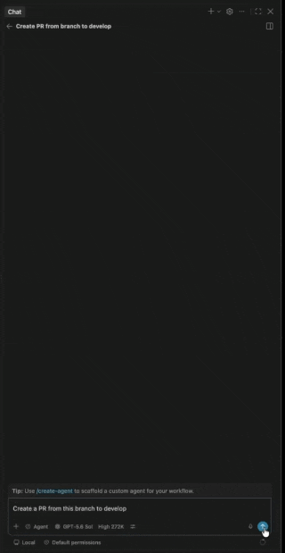
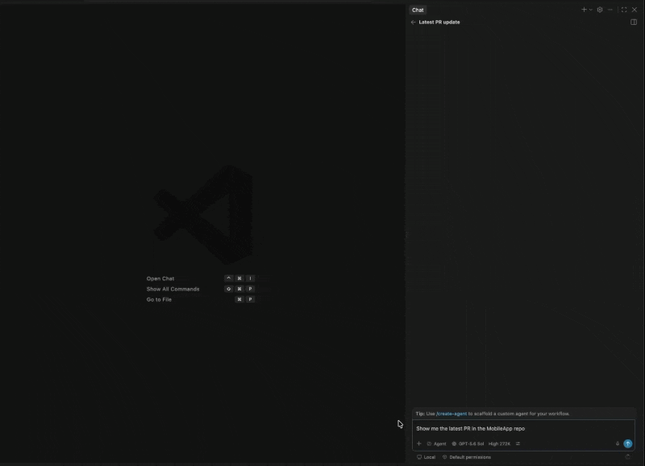

# Azure DevOps PRs for VS Code (MCP)

[](https://modelcontextprotocol.io/)

Review, draft, and check out Azure DevOps pull requests directly in GitHub Copilot Chat and VS Code AI Agents, without personal access tokens or API keys.

## See It in Action

### Create a Pull Request



### Review a Pull Request



## Key Features

- **Zero-configuration authentication:** Uses your existing VS Code Microsoft sign-in session. No personal access tokens, client IDs, client secrets, or credentials stored on disk.
- **Interactive pull request reviews:** Open a PR as an interactive review card with approvals, branches, changed files, comment counts, review state, and native VS Code actions.
- **Native diff and comments:** Open changed files in VS Code's native diff editor, create line comments, and reply to Azure DevOps discussion threads.
- **Smart PR drafts:** Let an agent prepare a local draft with a title, Markdown description, changed-file list, and reviewers before any remote change is made.
- **Automatic workspace discovery:** Finds Azure DevOps repositories in the open workspace and identifies the active repository when possible.
- **Branch checkout:** Check out a pull request source or target branch from the review card or through an agent.
- **Shared live state:** Review cards and the Activity Bar stay synchronized as files are reviewed, drafts change, or comments are added.

## Quick Start

1. Install the extension from the [Visual Studio Marketplace](https://marketplace.visualstudio.com/items?itemName=aitostack.azure-devops-prs-mcp), or run:

	```bash
	code --install-extension aitostack.azure-devops-prs-mcp
	```

2. Open a folder containing an Azure DevOps Git repository. Keep VS Code's built-in Git extension enabled.

3. Open GitHub Copilot Chat or another MCP-compatible agent host. VS Code discovers the local `Azure DevOps pull requests` MCP server automatically.

4. The extension reuses your existing Microsoft session. Only if prompted, run **Azure DevOps PRs (MCP): Sign In to Azure DevOps** from the Command Palette and complete the Microsoft sign-in flow.

## Example Prompts

| Action | Example prompt |
| --- | --- |
| List PRs | `Show me all open pull requests assigned to me in this repository.` |
| Review a PR | `Summarize the changes and active comments on PR #1042.` |
| Inspect a diff | `Open the diff for src/authentication.ts in PR #1042.` |
| Add a comment | `Add a comment on line 42 of src/authentication.ts in PR #1042: Please handle an expired token here.` |
| Draft a PR | `Create a pull request draft for my current branch targeting main.` |
| Find work items | `Find active work items whose title mentions authentication recovery.` |
| Link work items | `Link work items 1234 and 5678 to PR #1042.` |
| Check out a branch | `Check out the source branch for PR #847 locally.` |

## MCP Tools

The extension runs a local [Model Context Protocol](https://modelcontextprotocol.io/) server that gives agents access to these capabilities:

Use `get_pull_request` only when the user asks to display a pull request: it always opens an interactive review card. Use `get_pull_request_summary` for quiet inspection, reloads, and verification after a mutation; it returns JSON without opening a card. `update_pull_request` also returns JSON only, so existing cards refresh through their normal polling cycle rather than opening a duplicate card.

When Azure DevOps authentication is unavailable during background activity, VS Code adds a non-modal sign-in indication to the Accounts menu and shows one actionable sign-in notification every fifteen minutes at most. Agents must ask the user to run **Azure DevOps PRs (MCP): Sign In to Azure DevOps** once rather than invoking it or retrying it automatically.

| Tool | Purpose |
| --- | --- |
| `get_workspace_repositories` | Discover Azure DevOps repositories in the current workspace. |
| `list_pull_requests` | List active, completed, abandoned, or all pull requests. |
| `get_pull_request` | Show a pull request as an interactive review card with changed files. |
| `get_pull_request_summary` | Read a pull request as JSON without opening an interactive card. |
| `open_pull_request_file_diff` | Open a changed file in VS Code's native diff editor. |
| `open_pull_request_file` | Open the matching local workspace file. |
| `list_pull_request_comments` | List discussion threads and their file and line locations. |
| `add_pull_request_comment` | Create a general or line-level Azure DevOps comment. |
| `reply_to_pull_request_comment` | Reply to an existing discussion thread. |
| `approve_pull_request` | Approve a pull request as the signed-in user. |
| `checkout_pull_request_branch` | Check out a pull request source or target branch locally. |
| `set_pull_request_file_reviewed` | Mark a changed file as reviewed or not reviewed. |
| `list_pull_request_work_items` | List work items already linked to a pull request. |
| `query_work_items` | Query project work items with agent-defined WIQL filters and ordering, returning credentialed descriptions, acceptance criteria, and repro steps when available. |
| `link_pull_request_work_items` | Link selected work items to an existing pull request after explicit confirmation. |
| `create_pull_request` | Prepare an editable local pull request draft without creating a remote PR. |
| `submit_pull_request` | Create a remote pull request after explicit confirmation, optionally linking work items. |
| `update_pull_request` | Update an active pull request's title, description, or target branch after explicit confirmation, without opening a new card. |

## Pull Request Drafts

`create_pull_request` prepares a local draft instead of publishing immediately. Review and edit its title and description in the interactive card, then explicitly confirm before an agent calls `submit_pull_request`. Deleting a draft only removes its local shared state; it never deletes an Azure DevOps pull request.

## Security and Privacy

- **Local communication:** MCP communication stays on your machine and uses standard input/output.
- **Existing VS Code authentication:** The extension requests Azure DevOps access through VS Code's Microsoft authentication provider rather than storing credentials itself.
- **Official SDKs:** Built with the official MCP TypeScript SDK and `azure-devops-node-api`.
- **Session management:** Manage or sign out of the Microsoft account through VS Code's Accounts menu. Start a new agent conversation after an expired session is refreshed.

## Requirements

- VS Code 1.125.0 or later
- VS Code built-in Git extension enabled
- GitHub Copilot Chat or another MCP-compatible agent host
- Access to the relevant Azure DevOps organization and repositories

## Development

```bash
npm install
npm test
```

Run `npm run compile` to type-check, lint, and bundle the extension. Press `F5` in VS Code to launch an Extension Development Host.

## Feedback and Issues

Report bugs or request features in the [GitHub repository](https://github.com/uhvogala/azure-devops-mcp-vscode/issues).
